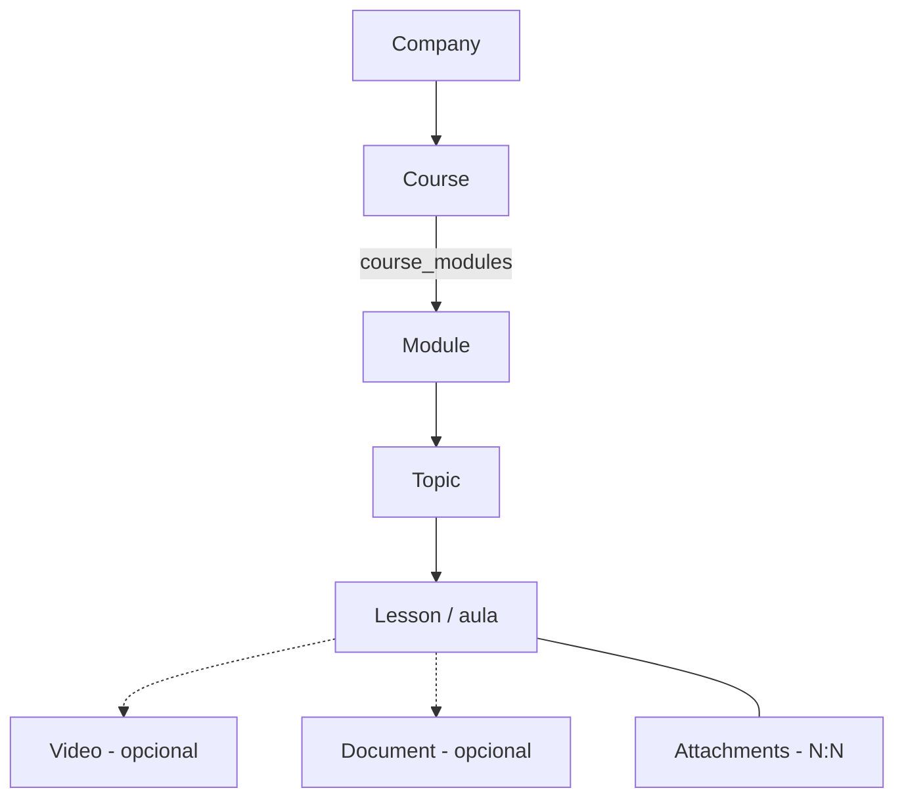
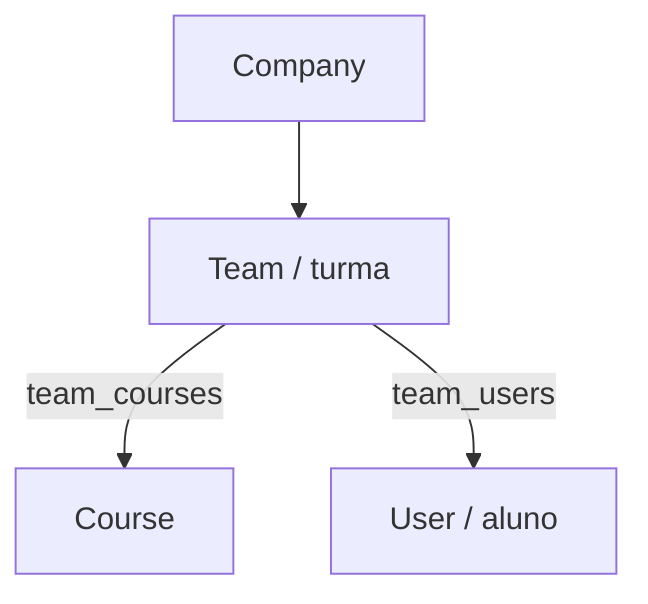
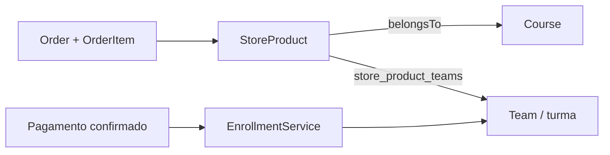
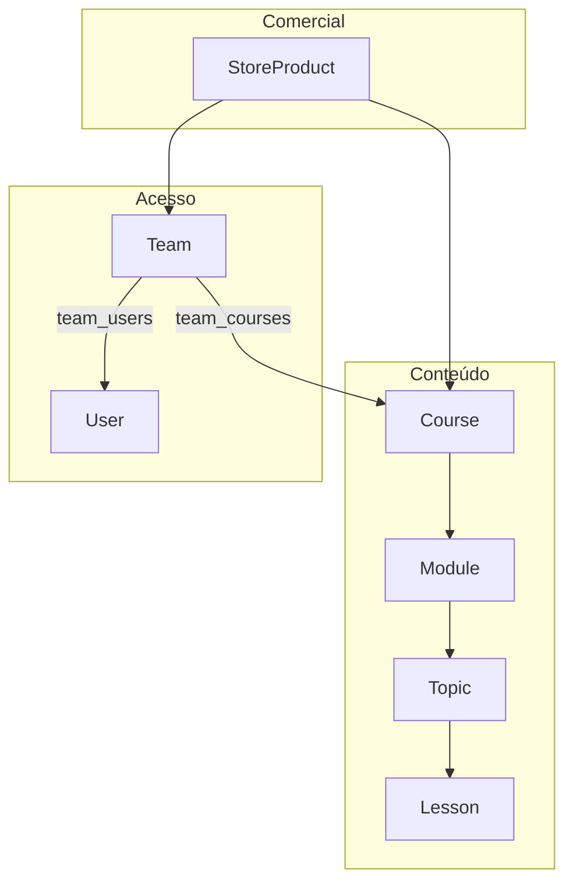
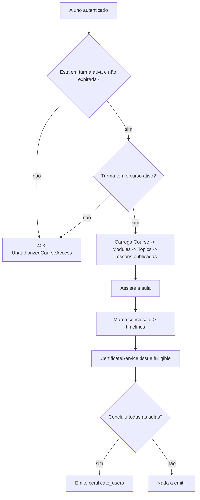

# Modelo de Domínio — Hierarquias

Este documento explica as **três hierarquias** do sistema e como elas se conectam:

1. **Conteúdo** — o que é ensinado (curso → módulo → tópico → aula).
2. **Acesso** — quem pode assistir (turma → aluno + curso).
3. **Comercial** — o que é vendido (produto → curso + turmas).

> Roteiro: a **aula** vive na hierarquia de conteúdo; o **aluno** ganha acesso pela hierarquia de acesso (turma); e o **produto** é apenas um dos caminhos para colocar o aluno na turma.

Todos os modelos pertencem a uma **Company** (tenant) via trait `BelongsToCompany` + `CompanyContext` (global scope + auto-fill de `company_id`).

---

## 1. Hierarquia de Conteúdo

```
Company (escola/tenant)
 └─ Course (curso)
     └─ Module (módulo)      ← N:N com Course via pivot course_modules
         └─ Topic (tópico)   ← pertence a UM módulo (topics.module_id)
             └─ Lesson (aula) ← pertence a UM tópico (lessons.topic_id)
                 ├─ Video      (opcional — lessons.video_id)
                 ├─ Document   (opcional — lessons.document_id)
                 └─ Attachments (N:N via lesson_attachments)
```



Pontos-chave:

- **Curso ↔ Módulo é N:N** (`course_modules`): o mesmo módulo pode ser reaproveitado em vários cursos.
- **Tópico pertence a um módulo** e **aula pertence a um tópico** — não existem ligados direto ao curso.
- Uma aula só aparece para o aluno se estiver **publicada**: `Lesson::isPublished()` = `status = active` **e** (`published_at` nulo **ou** no passado).
- O **produto (`store_products`) NÃO faz parte do conteúdo**. A aula existe sem produto nenhum.

Referências: `app/Models/Course.php`, `app/Models/Module.php`, `app/Models/Topic.php`, `app/Models/Lesson.php`.

---

## 2. Hierarquia de Acesso

```
Company
 └─ Team (turma)                 ← é a "ponte" de acesso
     ├─ users (alunos)  via team_users   (status, expired_at)
     └─ courses         via team_courses (status)
```



Regra central (em `StudentCourseService::activeEnrollmentConstraint` o aluno tem acesso a um curso quando **as duas** condições valem):

| Vínculo | Condição |
| ------- | -------- |
| `team_users` (aluno na turma) | `status = active` **e** (`expired_at` nulo **ou** `> agora`) |
| `team_courses` (curso na turma) | `status = active` |
| Curso / aula | `status = active` (e aula publicada) |

- **Sem turma não há aula.** O acesso nunca é concedido direto no curso.
- A checagem está centralizada em `StudentCourseService::assertAccess(...)`, que retorna a `Team` ativa usada para acessar o curso (e também é usada no progresso, pois `timelines` é escopada por turma).
- `user_types.code` (`admin` / `instructor` / `student`) é **permissão**, não acesso — é outro eixo, tratado por `role:` e Policies.

Referências: `app/Services/StudentCourseService.php`, `app/Models/Team.php`, `app/Models/User.php`.

---

## 3. Hierarquia Comercial (produto)

```
StoreProduct (produto)  ─ belongsTo ─> Course
        └─ teams (N:N via store_product_teams, pivot: status)
```



- O produto aponta para **um curso** (`store_products.course_id`) e para **uma ou mais turmas** (`store_product_teams`).
- Ao confirmar o pagamento, `EnrollmentService::grantAccess` percorre as turmas ativas do produto e faz:
  - `team_courses` → garante o **curso na turma**;
  - `team_users` → garante o **aluno na turma** (ativo, sem expiração).
- Ou seja: **comprar é só um atalho para entrar na turma.** O admin também pode cadastrar o aluno na turma diretamente.

Referências: `app/Services/EnrollmentService.php`, `app/Services/PaymentService.php`, `app/Models/StoreProduct.php`.

---

## 4. Como as três se conectam



O **Course** é o ponto onde conteúdo, acesso e comercial se encontram:

- Conteúdo pendura módulos/tópicos/aulas nele.
- Acesso liga o curso a turmas, e turmas a alunos.
- O produto é vendido apontando para o curso e para as turmas que serão liberadas.

### Fluxo completo para "assistir uma aula"



Passo a passo:

1. Admin cria `Curso → Módulos → Tópicos → Aulas` (publicadas).
2. Admin cria uma `Turma` e vincula o curso (`team_courses`).
3. Aluno entra na turma **por compra** (pagamento → `EnrollmentService`) **ou** por cadastro manual do admin.
4. `GET /me/courses` lista os cursos em que o aluno tem turma ativa.
5. `GET /me/courses/{course}` valida o acesso e retorna `modules → topics → lessons`.
6. `POST /me/progress/complete` grava `timelines` (idempotente) e tenta emitir certificado.

---

## 5. Tabelas pivot e colunas relevantes

Todas as pivots carregam `company_id` (multi-tenant) e `status`, e têm unique composto.

| Pivot | Liga | Colunas além de `id/created_at/updated_at` | Unique |
| ----- | ---- | ------------------------------------------ | ------ |
| `course_modules` | Course ↔ Module | `company_id`, `module_id`, `course_id`, `status`, `sort_order` | `company_id, course_id, module_id` |
| `team_courses` | Team ↔ Course | `company_id`, `team_id`, `course_id`, `status` | `company_id, team_id, course_id` |
| `team_users` | Team ↔ User | `company_id`, `team_id`, `user_id`, `status`, `expired_at` | `company_id, team_id, user_id` |
| `store_product_teams` | StoreProduct ↔ Team | `company_id`, `store_product_id`, `team_id`, `status` | `company_id, store_product_id, team_id` |
| `lesson_attachments` | Lesson ↔ Attachment | `company_id`, `lesson_id`, `attachment_id`, `status`, `sort_order` | `company_id, lesson_id, attachment_id` |

> `sort_order` controla a ordenação de exibição (módulos no curso, anexos na aula). Tópicos e aulas ordenam por seu próprio `sort_order`.

---

## 6. Exemplo real (seed de demonstração)

| Elemento | Valor |
| -------- | ----- |
| Company | `1` |
| Cursos | `Curso de PHP` (5 aulas, 1 concluída — 20%), `Curso de biju` (3 aulas, 0%) |
| Turma | `Turma Demo` |
| Aluno | `aluno@cursos.test` (ativo na Turma Demo, sem expiração) |

Nesse caso o aluno foi matriculado **direto na turma** (sem produto), pelo `DemoEnrollmentSeeder`. O produto/compra seria o caminho usado em produção para liberar o acesso automaticamente.

---

## 7. Respostas rápidas

- **Aluno precisa de turma para assistir?** Sim. Acesso é sempre via `Team`, com vínculo ativo e não expirado.
- **A aula precisa de módulo?** Sim, indiretamente: `aula → tópico → módulo → curso`.
- **A aula precisa de produto?** Não. Produto é só venda; ele libera acesso colocando o aluno na turma.
- **`user_type` dá acesso a curso?** Não — define permissão (admin/instrutor/aluno), não matrícula.
- **Curso pode ter o mesmo módulo duas vezes?** O vínculo é N:N, mas o unique `company_id, course_id, module_id` impede duplicar o mesmo módulo no mesmo curso.
- **Progresso é por aluno ou por turma?** Por **aluno + aula + curso + turma** (`timelines`), então trocar de turma refaz o progresso.

---

## Referências de código

| Assunto | Arquivo |
| ------- | ------- |
| Acesso do aluno | `app/Services/StudentCourseService.php` |
| Matrícula pós-pagamento | `app/Services/EnrollmentService.php` |
| Progresso e certificado | `app/Services/ProgressService.php`, `app/Services/CertificateService.php` |
| Modelos | `app/Models/{Course,Module,Topic,Lesson,Team,StoreProduct,User}.php` |
| Rotas do aluno | `routes/api/v1.php` (`me/courses`, `me/progress/complete`) |
| Tenant | `app/Support/CompanyContext.php`, `app/Concerns/BelongsToCompany.php` |
