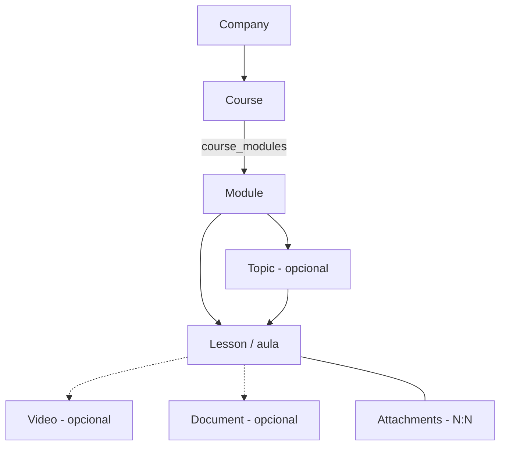
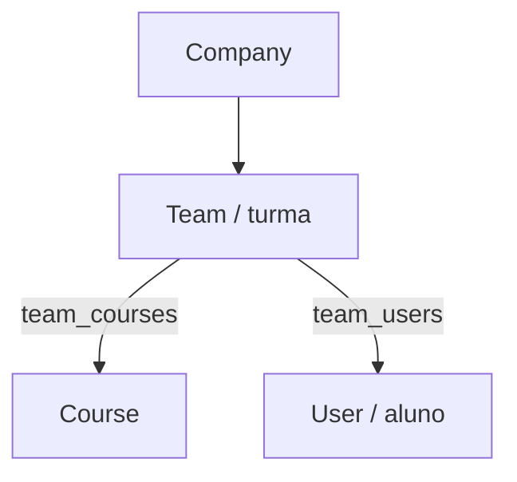
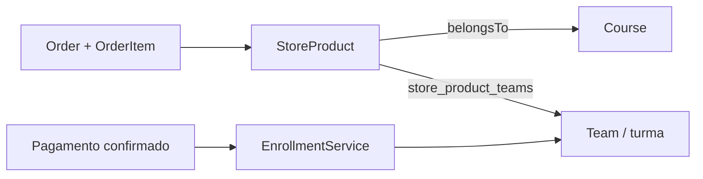
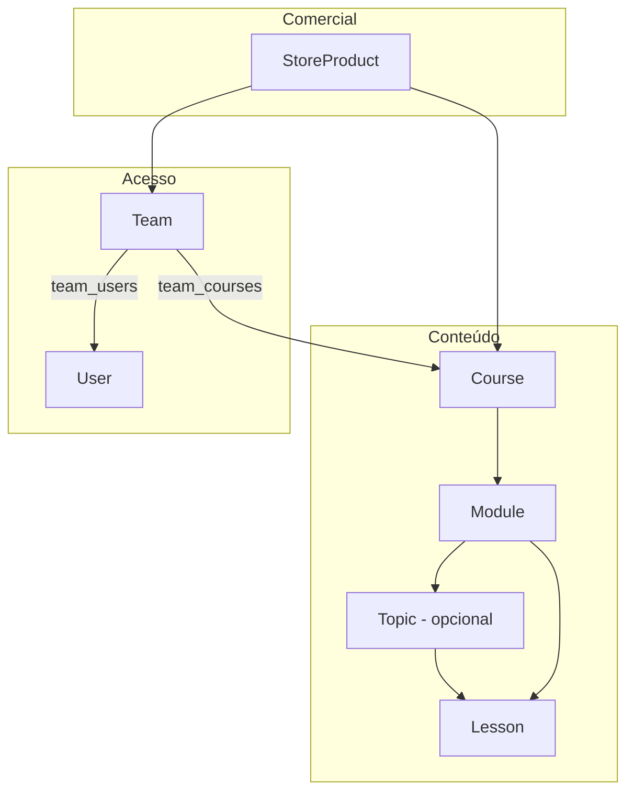

# Modelo de Domínio — Hierarquias

Este documento explica as **três hierarquias** do sistema e como elas se conectam:

1. **Conteúdo** — o que é ensinado (curso → módulo → tópico → aula).
2. **Acesso** — quem pode assistir (turma → aluno + curso).
3. **Comercial** — o que é vendido (produto → curso + turmas).

> Roteiro: a **aula** vive na hierarquia de conteúdo; o **aluno** ganha acesso pela hierarquia de acesso (turma); e o **produto** é apenas um dos caminhos para colocar o aluno na turma.

Todos os modelos pertencem a uma **Company** (tenant) via trait `BelongsToCompany` + `CompanyContext` (global scope + auto-fill de `company_id`).

---

## 1. Hierarquia de Conteúdo

```
Company (escola/tenant)
 └─ Course (curso)
     └─ Module (módulo)      ← N:N com Course via pivot course_modules
         ├─ Topic (tópico)   ← opcional, pertence a UM módulo (topics.module_id)
         │   └─ Lesson (aula) ← pertence a UM tópico (lessons.topic_id)
         └─ Lesson (aula)    ← pode pertencer só ao módulo (lessons.module_id, topic_id nulo)
             ├─ Video      (opcional — lessons.video_id, content_type = video)
             ├─ Document   (opcional — lessons.document_id, content_type = document; arquivo enviado ou link)
             └─ Attachments (N:N via lesson_attachments)
```



Pontos-chave:

- **Curso ↔ Módulo é N:N** (`course_modules`): o mesmo módulo pode ser reaproveitado em vários cursos.
- **Toda aula pertence a um módulo** (`lessons.module_id`) e **opcionalmente a um tópico** (`lessons.topic_id`): um módulo pode ter aulas com ou sem tópico. Tópico pertence a um módulo.
- Uma aula só aparece para o aluno se estiver **publicada**: `Lesson::isPublished()` = `status = active` **e** (`published_at` nulo **ou** no passado).
- **Tipo de conteúdo da aula:** `lessons.content_type` (`null`, `video` ou `document`) define a **mídia principal** exibida no player. Ao escolher um tipo, o serviço limpa os campos do outro tipo (uma aula de vídeo zera `document_id`; uma de documento zera `video_id`). Quando `content_type` não é enviado, ele é derivado dos campos preenchidos (`video_id` → video, senão `document_id` → document). `null` = aula sem mídia (só texto/HTML). Anexos (`lesson_attachments`) continuam sendo materiais complementares em qualquer tipo. Transmissões ao vivo pertencem ao módulo independente **Aulas ao vivo**. Enum: `app/Enums/LessonContentType.php`.
- **Assistir até o final (opcional):** `lessons.require_full_watch` (bool, padrão `false`). Quando ligado e a aula tem vídeo, o aluno só consegue concluir depois que o progresso de vídeo salvo (`video_progresses.position_seconds`) alcança a duração (tolerância de 2s). Sem vídeo vinculado a flag não tem efeito; o serviço zera a flag em aulas de documento.
- **Aba de comentários configurável:** `lessons.comments_enabled` (bool, padrão `true`). Quando `false`, a aba não aparece para o aluno e novos comentários são recusados (403). Comentários existentes são preservados e ficam ocultos; ao reativar, voltam a aparecer. A moderação admin continua enxergando todos.
- **Respostas em comentários:** `lessons.student_replies_enabled` (bool, padrão `true`). Quando `false`, alunos não podem criar novas respostas (403), mas administradores continuam podendo responder pela moderação. Respostas existentes permanecem visíveis. Respostas são threads de 1 nível: `comments.parent_id` aponta sempre para um comentário principal e é removido em cascata com o pai. O autor pode excluir o próprio comentário/resposta; excluir um comentário principal remove toda a thread, inclusive respostas de outros autores.
- O **produto (`store_products`) NÃO faz parte do conteúdo**. A aula existe sem produto nenhum.

Referências: `app/Models/Course.php`, `app/Models/Module.php`, `app/Models/Topic.php`, `app/Models/Lesson.php`.

---

## 2. Hierarquia de Acesso

```
Company
 └─ Team (turma)                 ← é a "ponte" de acesso
     ├─ users (alunos)  via team_users   (status, expired_at)
     └─ courses         via team_courses (status)
```



Regra central (em `StudentCourseService::activeEnrollmentConstraint` o aluno tem acesso a um curso quando **as duas** condições valem):

| Vínculo | Condição |
| ------- | -------- |
| `teams` (turma) | `status = active` |
| `team_users` (aluno na turma) | `status = active` **e** (`expired_at` nulo **ou** `> agora`) |
| `team_courses` (curso na turma) | `status = active` |
| Curso / aula | `status = active` (e aula publicada) |

- **Sem turma não há aula.** O acesso nunca é concedido direto no curso.
- **Turma inativa bloqueia o acesso.** Inativar uma turma corta o acesso de todos os alunos matriculados aos cursos associados até que ela seja reativada (nada é apagado; reativar restaura).
- A checagem está centralizada em `StudentCourseService::assertAccess(...)`, que retorna a `Team` ativa usada para acessar o curso (e também é usada no progresso, pois `timelines` é escopada por turma).
- A compra (`EnrollmentService::grantAccess`) **ignora** turmas inativas — não cria `team_courses`/`team_users` por elas.
- `user_types.code` (`admin` / `instructor` / `student`) é **permissão**, não acesso — é outro eixo, tratado por `role:` e Policies.

Referências: `app/Services/StudentCourseService.php`, `app/Models/Team.php`, `app/Models/User.php`.

### 2.1 Liberação programada (drip)

Além da matrícula, o admin pode agendar a **data de liberação** de um conteúdo por turma, em três níveis: **curso**, **módulo** e **aula**. Fica na tabela `schedules` (Team + `schedulable_type`/`schedulable_id` polimórfico + `available_at`).

Regra:

- A data é sempre "a partir de" (não há data de encerramento).
- Quando há mais de uma data aplicável (curso + módulo + aula), vale a **mais restritiva** — o conteúdo libera quando **todas** já passaram (`ScheduleService::effectiveAt` = `max`).
- Sem registro = sem agendamento (nada bloqueado). Limpar = apagar a linha.
- O bloqueio vale **só para a aula** (iniciar/concluir/assistir e salvar posição de vídeo). Documentos e anexos continuam acessíveis se a aula estiver bloqueada.
- Aulas bloqueadas **contam** no total do curso (o certificado sai quando todas forem concluídas).

O enforcement roda em `StudentCourseService::assertLessonUnlocked` (junto do pré-requisito), chamado por `ProgressService` e `VideoProgressService`. O conteúdo do aluno expõe `available_at` e `is_locked` em curso/módulo/aula.

Referências: `app/Services/ScheduleService.php`, `app/Models/Schedule.php`, `app/Enums/ScheduleLevel.php`.

---

## 3. Hierarquia Comercial (produto)

```
StoreProduct (produto)  ─ belongsTo ─> Course
        └─ teams (N:N via store_product_teams, pivot: status)
```



- O produto é definido por **uma ou mais turmas** (`store_product_teams`). O formulário não escolhe curso.
- `store_products.course_id` é um **curso principal derivado** do primeiro curso ativo das turmas selecionadas. Ele é usado apenas em relatórios (ex.: top cursos) e continua presente na resposta da API.
- Ao confirmar o pagamento, `EnrollmentService::grantAccess` percorre as turmas ativas do produto e faz:
  - `team_courses` → garante o curso principal na turma (redundante quando o vínculo já existe);
  - `team_users` → garante o **aluno na turma** (ativo, sem expiração).
- Ou seja: **comprar é só um atalho para entrar na turma.** O admin também pode cadastrar o aluno na turma diretamente.

Referências: `app/Services/EnrollmentService.php`, `app/Services/PaymentService.php`, `app/Models/StoreProduct.php`.

---

## 3.1 Vendedores e indicação

```
Seller (vendedor)  →  orders.seller_id / subscriptions.seller_id  →  seller_commissions
       ↓
share_token do kit  →  links ?ref=code  →  atribuição por 30 dias
```

- **Vendedor não é usuário.** `sellers` guarda código, percentual, status e token do kit; o vínculo opcional `user_id` serve apenas para identificar a pessoa e não concede login nem permissão.
- O vendedor não precisa de conta para compartilhar produtos. O admin envia o kit secreto e o vendedor copia os links com `?ref=code`.
- A atribuição é capturada no navegador por 30 dias, enviada no cadastro/pedido/assinatura e validada no backend. O último código válido vence.
- Pedidos e assinaturas congelam `seller_id`, `referral_code` e `commission_percent`. Assinaturas renovam a comissão em cada cobrança.
- A comissão é um extrato por item (`seller_commissions`); a base é o valor após desconto rateado, e estornos ajustam ou revertem o valor.
- O vendedor pode ser inativado; o kit deixa de responder e novos códigos não são atribuídos, mas o histórico permanece.

## 4. Como as três se conectam



O **Course** é o ponto onde conteúdo, acesso e comercial se encontram:

- Conteúdo pendura módulos/tópicos/aulas nele.
- Acesso liga o curso a turmas, e turmas a alunos.
- O produto é vendido apontando para o curso e para as turmas que serão liberadas.

### Fluxo completo para "assistir uma aula"

```mermaid
flowchart TD
    A[Aluno autenticado] --> B{Está em turma ativa e não expirada?}
    B -- não --> X[403 UnauthorizedCourseAccess]
    B -- sim --> C{Turma tem o curso ativo?}
    C -- não --> X
    C -- sim --> D[Carrega Course -> Modules -> (Topics ->) Lessons publicadas]
    D --> E[Assiste a aula]
    E --> F[Marca conclusão -> timelines]
    F --> G[CertificateService::issueIfEligible]
    G --> H{Concluiu todas as aulas atuais?}
    H -- sim --> I[Emite ou substitui certificate_users]
    H -- não --> J[Mantém o certificado atual]
```

Passo a passo:

1. Admin cria `Curso → Módulos → (Tópicos →) Aulas` (publicadas). A aula pode ficar direto no módulo, sem tópico.
2. Admin cria uma `Turma` e vincula o curso (`team_courses`).
3. Aluno entra na turma **por compra** (pagamento → `EnrollmentService`) **ou** por cadastro manual do admin.
4. `GET /me/courses` lista os cursos em que o aluno tem turma ativa.
5. `GET /me/courses/{course}` valida o acesso e retorna `modules → topics → lessons` mais as `modules.lessons` (aulas sem tópico).
6. `POST /me/progress/complete` grava `timelines` (idempotente) e tenta emitir certificado.
7. A conclusão é registrada em **`course_completions`** (user+team+course, `required_lessons`, `lesson_ids`, `completed_at`) e representa o **marco mais recente** do aluno. O status `completed` vem dessa tabela (não da contagem isolada de aulas). Quando novas aulas são adicionadas, o certificado atual continua válido com a grade antiga até o aluno concluir todas as novas aulas. Nesse momento, `course_completions` avança para o novo total, `CertificateService::issueIfEligible` emite um novo certificado com a grade atual e o anterior é invalidado como **Substituído** (mantendo o snapshot antigo no histórico). Revogar o documento manualmente **não** remove a conclusão e não é reemitido automaticamente.
8. A apresentação da grade (`modules_placement`) e o layout da página separada (`modules_layout`, `modules_title`, `modules_background`) ficam no template. Um template com qualquer certificado emitido não pode ser editado: o admin cria uma nova versão (que pode ser ajustada enquanto não tiver alunos) e transfere os certificados **válidos** para ela. A transferência troca apenas o modelo exibido; código, data de emissão, carga e `modules` congelados são preservados. Revogados e substituídos continuam no modelo antigo.
9. Cada certificado válido tem uma página pública em `${FRONTEND_URL}/v/{codigo}`, sem login e sem `X-Company`: o código público curto resolve o certificado (UUIDs antigos também são aceitos). Links/QRs de certificados substituídos automaticamente redirecionam para o certificado válido atual; revogados manualmente continuam indisponíveis. A página e o endpoint público usam `noindex`/`X-Robots-Tag` e mostram apenas nome do titular, curso, carga, data e dados visuais. O template pode habilitar `qr_enabled` para imprimir no certificado um QR que aponta para essa página. `qr_placement` escolhe frente, página da grade (`modules`) ou ambas; o campo `qr` de `layout`/`modules_layout` define posição e tamanho em cada página.

---

## 5. Tabelas pivot e colunas relevantes

Todas as pivots carregam `company_id` (multi-tenant) e `status`, e têm unique composto.

| Pivot | Liga | Colunas além de `id/created_at/updated_at` | Unique |
| ----- | ---- | ------------------------------------------ | ------ |
| `course_modules` | Course ↔ Module | `company_id`, `module_id`, `course_id`, `status`, `sort_order` | `company_id, course_id, module_id` |
| `team_courses` | Team ↔ Course | `company_id`, `team_id`, `course_id`, `status` | `company_id, team_id, course_id` |
| `team_users` | Team ↔ User | `company_id`, `team_id`, `user_id`, `status`, `expired_at` | `company_id, team_id, user_id` |
| `store_product_teams` | StoreProduct ↔ Team | `company_id`, `store_product_id`, `team_id`, `status` | `company_id, store_product_id, team_id` |
| `lesson_attachments` | Lesson ↔ Attachment | `company_id`, `lesson_id`, `attachment_id`, `status`, `sort_order` | `company_id, lesson_id, attachment_id` |
| `schedules` | Team ↔ (Course/Module/Lesson, polimórfico) | `company_id`, `team_id`, `schedulable_type`, `schedulable_id`, `available_at` | `company_id, team_id, schedulable_type, schedulable_id` |

> `sort_order` controla a ordenação de exibição (módulos no curso, anexos na aula). Tópicos e aulas ordenam por seu próprio `sort_order`. Aulas sem tópico usam `lessons.sort_order` dentro do módulo e aparecem **depois** dos tópicos.

---

## 6. Exemplo real (seed de demonstração)

| Elemento | Valor |
| -------- | ----- |
| Company | `1` |
| Cursos | `Curso de PHP` (5 aulas, 1 concluída — 20%), `Curso de biju` (3 aulas, 0%) |
| Turma | `Turma Demo` |
| Aluno | `aluno@cursos.test` (ativo na Turma Demo, sem expiração) |

Nesse caso o aluno foi matriculado **direto na turma** (sem produto), pelo `DemoEnrollmentSeeder`. O produto/compra seria o caminho usado em produção para liberar o acesso automaticamente.

---

## 7. Respostas rápidas

- **Aluno precisa de turma para assistir?** Sim. Acesso é sempre via `Team`, com vínculo ativo e não expirado.
- **A aula precisa de módulo?** Sim, diretamente: `lessons.module_id`. O tópico (`lessons.topic_id`) é opcional — unidade organizacional dentro do módulo.
- **A aula precisa de produto?** Não. Produto é só venda; ele libera acesso colocando o aluno na turma.
- **`user_type` dá acesso a curso?** Não — define permissão (admin/instrutor/aluno), não matrícula.
- **Curso pode ter o mesmo módulo duas vezes?** O vínculo é N:N, mas o unique `company_id, course_id, module_id` impede duplicar o mesmo módulo no mesmo curso.
- **Progresso é por aluno ou por turma?** Por **aluno + aula + curso + turma** (`timelines`), então trocar de turma refaz o progresso.
- **Dá para agendar a liberação de uma aula?** Sim, por turma, no nível curso/módulo/aula (`schedules`). Vale a data mais tardia; o aluno só acessa a aula depois dela.

---

## Referências de código

| Assunto | Arquivo |
| ------- | ------- |
| Acesso do aluno | `app/Services/StudentCourseService.php` |
| Agendamento (drip) | `app/Services/ScheduleService.php`, `app/Models/Schedule.php` |
| Matrícula pós-pagamento | `app/Services/EnrollmentService.php` |
| Progresso e certificado | `app/Services/ProgressService.php`, `app/Services/CertificateService.php` |
| Modelos | `app/Models/{Course,Module,Topic,Lesson,Team,StoreProduct,User}.php` |
| Rotas do aluno | `routes/api/v1.php` (`me/courses`, `me/progress/complete`) |
| Tenant | `app/Support/CompanyContext.php`, `app/Concerns/BelongsToCompany.php` |
| Dominio do tenant | `app/Http/Middleware/ResolveCompanyByDomain.php`, `app/Models/Company.php` |

---

## 8. Tenant por dominio

Cada empresa pode ter um `domain` unico. Ele e o endereco principal da loja, do login e do painel:

- Loja publica: `https://{domain}/`
- Produto: `https://{domain}/produto/{slug}`
- Login/cadastro: `https://{domain}/entrar` e `https://{domain}/cadastro`
- Painel do aluno/admin: `https://{domain}/inicio`
- Certificado publico: `https://{domain}/v/{codigo}`

O middleware `company.domain` resolve a empresa pelo header `X-Company-Domain` (ou `X-Forwarded-Host`/`Host`) e define `CompanyContext`. Dominios em `PLATFORM_DOMAINS` pertencem ao painel central e nao resolvem tenant. As rotas `/e/{slug}/...` continuam como fallback local/legado; empresas sem dominio usam esse formato.

O dominio identifica o tenant, mas nao substitui autorizacao: rotas autenticadas sempre usam a empresa do usuario/token. O servidor precisa de DNS/TLS por dominio e fallback SPA para `index.html` (mantendo `/v/*` para `verificar.html`).

Para testar localmente, mapeie o host (ex.: `ourovelho.test` para `127.0.0.1`), use `VITE_PLATFORM_DOMAINS=localhost,127.0.0.1` e acesse `http://ourovelho.test:5174`. O Vite de desenvolvimento aceita hosts customizados (`server.allowedHosts`); em producao a regra fica no proxy/Nginx. Defina `FRONTEND_SCHEME=http` no `.env` local se os links gerados pelo backend forem abertos via HTTP.
